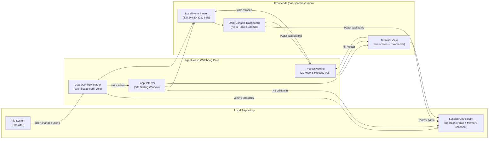

<div align="center">


<br />

**Stop runaway AI coding agents from thrashing your repo, overwriting `.env` files, or leaving forgotten MCP processes behind — with one command, on your machine, no account, no telemetry.**

[](https://www.npmjs.com/package/agent-leash)
[](#)
[](./tsconfig.json)
[](./package.json)
[](#security-model)
[](./LICENSE)

```bash
npx agent-leash
```


<sub>The animation predates the full-screen terminal view; run <code>npx agent-leash --demo</code> to see the current one.</sub>

</div>

---

## Why `agent-leash`?

Rules inside `AGENTS.md` or `CLAUDE.md` are polite suggestions. They **cannot** stop an autonomous coding agent once it hallucinates inside a debugging loop or when a local MCP server silently deadlocks in the background.

`agent-leash` is a small runtime circuit breaker that sits next to Claude Code, Cursor, Codex, or Antigravity and watches your file system and OS processes:

| Failure Mode in Autonomous Runs | Without `agent-leash` | With `agent-leash` |
| :--- | :--- | :--- |
| **Edit Thrashing** *(agent rewrites the same file 6× in 30s trying to fix a test)* | Burns tokens and leaves broken code across the working tree | **Circuit Breaker trips** on edit #6 and reverts the file; the version it replaces is kept |
| **Secret / Infra Tampering** *(agent edits `.env.local` or `docker-compose.yml`)* | Secrets or container configs get modified silently | **Instant Alert & Infra Restore** (`.env*` warns immediately without reading/writing secrets; `docker-compose.yml` auto-reverts) |
| **Forgotten Multi-Day Agent & MCP Sessions** *(old sessions from other repos stay alive for days)* | Hundreds of MB of RAM silently locked by stale `claude-code` & MCP trees | **Cross-Repo CWD & Uptime Analysis** flags `STALE` processes (`SAFE TO KILL`) and shows reclaimable RAM in MB |
| **Runaway Multi-File Refactor** *(agent modifies 40+ unintended files)* | Painful manual `git checkout` / untracked file cleanup | **Red Panic Button** restores tracked & untracked files to initial state |

---

## Zero-Friction Quickstart (Time to First Wow: 5 Seconds)

No account, no API keys, no config file required. Run directly in any repository:

```bash
# 1. Protect your current repository: live view in this terminal, dashboard on http://localhost:4321
npx agent-leash

# 2. Or try the simulation first (a rogue agent and stale processes; changes no file and no process)
npx agent-leash --demo
```

Stop it by typing `exit` (or `q`, or Ctrl+C).

Want other limits or more protected files in this repository? See and change the settings from the terminal (details in [Configuration](#configuration)):

```bash
npx agent-leash config                      # every setting, its value and where it comes from
npx agent-leash config set maxFilesWarn 25  # change one value; a running agent-leash applies it at once
```

---

## In the Terminal

Started in a terminal, `agent-leash` shows a full-screen live view of the same state the dashboard shows: mode, modified files, circuit breaker, the activity log and the process table. A command line at the bottom does what the dashboard buttons do:

| Command | What it does |
| :--- | :--- |
| `exit`, `quit`, `q` | Stop the watchdog (Ctrl+C and Ctrl+D work too) |
| `mode <strict\|balanced\|yolo>` | Switch the guard mode (saved to `.agentguard.json` if the repository has one) |
| `revert <file>` | Roll one modified file back to the session checkpoint (Tab completes file names) |
| `kill <pid>` | Terminate one process from the list: SIGTERM first, SIGKILL if it does not exit |
| `clean` | Terminate everything classified as stale or frozen |
| `panic` | Kill the agent and MCP processes of this repository and roll back all files |
| `status` | List all monitored processes |
| `help` | Show the commands |

`revert`, `kill`, `clean` and `panic` ask `[y/N]` before they act.

Without a terminal (a pipe, a log file, a background job, or `--no-tui`) the same information is printed as one line per event, and the same commands are read from stdin, one per line. The end of the input does not stop the watchdog; `kill -TERM` does.

```bash
npx agent-leash watch ./my-repo --no-dashboard     # terminal only, no web server
npx agent-leash watch ./my-repo --no-tui --quiet   # log lines, alerts only
npx agent-leash watch ./my-repo --no-auto-rollback # observe and alert, never rewrite a file
npx agent-leash status                             # one-time process table
```

---

## How It Works (Architecture)



### Key Engineering Details

1. **Dual-Layer Session Checkpoint (`git stash create` + Memory Snapshot, Zero-Secret-Access for `.env*`)**: On startup, `agent-leash` creates an invisible Git commit object without touching your working tree or stash reflog, paired with an in-memory snapshot for code files. `.env*` files are strictly metadata-monitored (warn-only): their contents are **never** read into memory or overwritten on disk.
2. **Rollbacks That Lose Nothing**: Before a rollback overwrites or removes a file, the version being replaced is copied to a private temp directory (the path is in the log and in the exit summary). A rollback only touches files inside the watched repository, and only deletes files that were created during the session. `agent-leash` recognizes the file system echo of its own rollback by content, so the rollback never triggers a second alert.
3. **Smart Process Lifecycle (`STANDBY` vs. `STALE` vs. `FROZEN`)**: Naive watchdogs flag every `0% CPU` MCP server as frozen—even though stdio MCP servers legitimately sit at `0% CPU` waiting for tool calls. `ProcessMonitor` inspects the process tree (`PPID`), working directory (`lsof -d cwd`), physical RAM (`RSS` in MB), and uptime (`etime`) to distinguish **healthy standby MCP children** (`STANDBY`) from **forgotten multi-day sessions in other repos** (`STALE · SAFE TO KILL`) and **hung/orphaned processes** (`FROZEN`).

---

## Choosing a Mode

The mode decides how file volume and protected files are judged. The circuit breaker (more than 5 edits to one file within 60 seconds) and the process monitor work the same in every mode.

| Mode | Modified files | Protected files | Use it when |
| :--- | :--- | :--- | :--- |
| **`strict`** | Hard-stop alarm at **15** | Every pattern | An agent should make a small, targeted change: a bugfix, a hotfix, work in a sensitive repository, or a run you do not follow closely |
| **`balanced`** *(default)* | Warning at **15**, hard-stop alarm at **40** | Every pattern | Everyday work with an agent you keep an eye on |
| **`yolo`** | No limit | Only `.env*` and `.git` patterns; every other pattern is off, including your own | You expect the agent to touch many files on purpose (renames, migrations, formatter runs, dependency upgrades) and you are watching |

What this means in practice:

- **Protected files** are reverted as soon as they change, and the replaced version is kept. `.env*` files only raise a warning, because agent-leash never reads their contents. With `--no-auto-rollback` nothing is reverted in any mode; you get the alert only.
- **A hard stop is an alarm, not a brake.** Reaching a file limit raises an alarm in the terminal view, the log and the dashboard. It does not stop the agent; `panic` does, after asking.
- The numbers above are the defaults. Every one of them can be changed, see [Configuration](#configuration).

Choose the mode for one run with `--mode`, or switch it while running with `mode <name>` in the terminal view or the buttons in the dashboard.

---

## Configuration

agent-leash works without any configuration. To change a value for one repository, put an `.agentguard.json` in its root. Commit it if your team should share the settings, or add it to `.gitignore` if they are yours alone.

```bash
npx agent-leash config                       # every setting: value, where it comes from, what it does
npx agent-leash config set maxFilesWarn 25   # change one value (creates the file if needed)
npx agent-leash config set protectedFiles '.env*, docker-compose*.yml, secrets/**'
npx agent-leash config unset maxFilesWarn    # back to the default
npx agent-leash init                         # or write a file with every default, to edit by hand
```

`config set` and `config unset` change one key and leave the rest of the file as it is; `-C <dir>` points them at another repository. Keys work with or without the `limits.` prefix.

| Setting | Default | What it does |
| :--- | :--- | :--- |
| `mode` | `balanced` | `strict`, `balanced` or `yolo`, see [Choosing a Mode](#choosing-a-mode) |
| `limits.maxFilesWarn` | `15` | Files modified in this session before a warning (in `strict`: the hard-stop alarm) |
| `limits.maxFilesHardStop` | `40` | Files modified in this session before the hard-stop alarm |
| `limits.maxEditsPerFilePerMinute` | `5` | Edits to one file within 60 seconds before the circuit breaker reverts it |
| `limits.mcpSilenceTimeoutSec` | `45` | Seconds without CPU or file activity before a process counts as frozen |
| `limits.staleSessionHours` | `6` | Hours after which an agent session in another repository counts as stale |
| `protectedFiles` | `.env*`, `docker-compose*.yml`, `.git/**` | Globs relative to the repository root. Your list replaces the default one, so keep `.env*` in it if you want those warnings |

**Changes apply while agent-leash runs.** A saved change is picked up within about a second, whether it comes from `config set` or from your editor, and the activity log says what changed, for example `.agentguard.json reloaded: limits.maxFilesWarn 15 → 25`. Reloads are logged as warnings, so they also show with `--quiet`: the agent you are watching can write this file as easily as you can. An edit that is not valid (broken JSON, a limit below 1) is not applied at all; the previous settings stay and the log says why. At startup, an invalid value falls back to its default with a warning. Edits to `.agentguard.json` itself are never counted as agent edits and never reverted.

**Which mode wins.** `--mode` sets the mode for one run and leaves the file alone. A mode switch in the terminal view or the dashboard is saved to `.agentguard.json` if the repository has one, and only the `mode` key changes. Without a file, the switch lasts for this session. A mode you write into the file while agent-leash runs takes over again. In short: the most recent choice wins. The demo never writes the file.

**One repository per instance, every process in view.** File guarding is per repository: each watched repository has its own checkpoint and its own settings. There is no global configuration file. The process monitor is machine-wide: every instance lists the agent and MCP processes of the whole machine, and `limits.staleSessionHours` decides when a session in another repository counts as stale. To guard several repositories, start one agent-leash in each; if the default dashboard port is taken, the next free one is used.

<details>
<summary><strong>Every setting in one file</strong> (the values <code>agent-leash init</code> writes)</summary>

```json
{
  "mode": "balanced",
  "protectedFiles": [".env*", "docker-compose*.yml", ".git/**"],
  "limits": {
    "maxFilesWarn": 15,
    "maxFilesHardStop": 40,
    "maxEditsPerFilePerMinute": 5,
    "mcpSilenceTimeoutSec": 45,
    "staleSessionHours": 6
  }
}
```
</details>

---

## Programmatic TypeScript API

`agent-leash` ships with TypeScript declarations and can be embedded into custom agent runners. Importing it never starts the CLI.

```ts
import {
  GuardConfigManager,
  ProcessMonitor,
  RepoWatcher,
  WatchdogSession,
  listenWatchdogServer,
} from 'agent-leash';

const rootDir = process.cwd();
const configManager = new GuardConfigManager(rootDir, { mode: 'balanced' });
const watcher = new RepoWatcher({ rootDir, configManager });
const processMonitor = new ProcessMonitor({ rootDir, mcpSilenceTimeoutSec: 45 });

// One session: every front end reads its snapshot and acts through it
const session = new WatchdogSession({ rootDir, configManager, watcher, processMonitor });
session.on('event', (event) => console.log(event.severity, event.message));

await watcher.start();
processMonitor.start();

const dashboard = await listenWatchdogServer({ rootDir, configManager, watcher, processMonitor, session });
console.log(dashboard.url);
```

---

## Security Model

`agent-leash` can terminate processes and rewrite files, so its own surface is kept small:

- The dashboard server binds to `127.0.0.1` and answers only when addressed as this machine.
- Every state-changing request needs a token that is only handed to the dashboard page, and must come from that page's own origin. A web page in another tab cannot trigger anything.
- Only processes from the monitored list can be terminated, and only paths inside the watched repository can be rolled back. `.env*` files are never read, written or copied.
- File names and command lines are treated as untrusted text in the dashboard and in the terminal.
- Found a vulnerability? Please report it privately, see [`SECURITY.md`](./SECURITY.md).
- Known limits: another user account on the same machine, or the watched agent itself, can still reach the local dashboard. The watched agent can also edit `.agentguard.json`; a running agent-leash applies the edit and logs it as a warning. The dashboard page loads Tailwind from its CDN; with `--no-dashboard` no network request is made at all.

## Platform Support

Verified on macOS. Linux is implemented but not yet verified, and its process classification is less reliable. Windows is not supported: file watching works, process monitoring does not.

---

## Project Structure

```text
agent-leash/
├── assets/                  # SVG banner, demo animation & Charmbracelet VHS tape
├── scripts/
│   ├── agents/              # Guard hook for coding agents working on this repo
│   └── scenarios/           # Sandbox repo, pseudo-terminal driver, package check
├── src/
│   ├── cli.ts               # Binary entry point
│   ├── index.ts             # Library entry point (importing it starts nothing)
│   ├── program.ts           # Commands, argument validation, wiring, shutdown
│   ├── server.ts            # Hono HTTP server, request guards & SSE stream (/api/events)
│   ├── core/
│   │   ├── session.ts       # One snapshot and one set of actions for every front end
│   │   ├── watcher.ts       # Chokidar file watcher, checkpoint, rollback & kept copies
│   │   ├── loop-detector.ts # 60-second sliding-window thrashing circuit breaker
│   │   ├── process-monitor.ts # Process list, classification & graceful termination
│   │   └── guard-config.ts  # .agentguard.json manager, validation & glob matcher
│   └── ui/
│       ├── terminal.ts      # Full-screen terminal view with command line
│       ├── plain.ts         # Line output for pipes, logs and background jobs
│       ├── commands.ts      # Command language shared by both terminal front ends
│       ├── format.ts        # Sanitizing, truncation, colors, tables
│       └── public/
│           └── index.html   # Zero-build Dark Console SPA (Tailwind + Native Dialog)
└── tests/                   # Vitest: unit, API, dashboard script, CLI end-to-end
```

## Contributing & Local Development

```bash
git clone https://github.com/uwejettkant/agent-leash.git
cd agent-leash
npm install

npm run check     # Typecheck, 169 automated tests (Vitest), build — the gate before every commit
npm test          # Tests only
npm run build     # Bundle library, binary and .d.ts types via tsup
npm run demo      # Simulated session, touches nothing
npm run dev       # Watch this repo in observe-only mode (--no-auto-rollback)
```

Development needs Node 22.12 or newer. Rules for coding agents working on this repository are in [`AGENTS.md`](./AGENTS.md). Bugs and feature requests go into GitHub issues; security problems are reported privately, see [`SECURITY.md`](./SECURITY.md).

## License

Released under the [MIT License](./LICENSE). Copyright © 2026 [Uwe Jettkant](https://uwe-jettkant.de).
