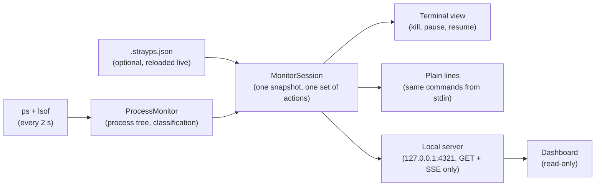

<div align="center">


<br />

**See every AI coding agent and MCP server running on your machine, find the ones left behind, and end them one session at a time. Local only: no account, no telemetry.**

[](#)
[](./tsconfig.json)
[](./package.json)
[](#security-model)
[](./LICENSE)

```bash
strayps
```

</div>

---

## Why `strayps`?

Coding agents run for hours, in several repositories at once, and each one starts its own MCP servers. Close the editor window or lose the terminal tab, and those processes often keep running: days later they still hold hundreds of megabytes, and nothing tells you which ones are still in use.

`strayps` lists them for the whole machine, says what each one is attached to and how long it has been quiet, and lets you end the one you pick, together with the MCP servers it started. It ends nothing on its own: every action asks first, and names each process it will end.

What it does not do: it does not watch your files (use git, or the checkpoints of your agent, such as `/rewind` in Claude Code), and it does not show token costs, context or tool calls of a session (tools like [agtop](https://github.com/ldegio/agtop) do).

---

## Quickstart

strayps is not on npm yet. Until it is, install it from a clone; building it needs Node 22.12 or newer, as development does:

```bash
git clone https://github.com/uwejettkant/strayps.git
cd strayps && npm install && npm run build
npm link        # puts strayps on your PATH; npm unlink -g strayps removes it again
```

No account, no API keys, no config file:

```bash
strayps            # live view in this terminal, read-only dashboard on http://localhost:4321
strayps status     # print the process table once, read-only
strayps --demo     # try a simulation first: ends and pauses nothing real
```

Stop it by typing `exit` (or `q`, or Ctrl+C).

---

## Finding Processes Left Behind

Each row shows the process, what kind it is (`agent`, `mcp` or `child`), its working directory, the app or terminal it is attached to (VS Code, Claude Desktop, a terminal …), its age, its memory, and a status. Where a row is too long, the command and the directory are cut before the app is. Piped into a file, `status` is 120 characters wide, or as wide as `COLUMNS` says. Memory is the physical footprint, the value Activity Monitor shows; where it cannot be read (on Linux, or for another user's process) the resident size (RSS) stands in, marked with `~` because it can be far off in both directions:

| Status | What strayps observed |
| :--- | :--- |
| `ACTIVE` | It used CPU time since the last scan |
| `IDLE` | It used none; an agent of the repository strayps was started in is only ever `ACTIVE` or `IDLE` |
| `STANDBY` | An MCP server whose parent is alive, waiting for its next tool call. An MCP server of an editor or desktop app that is still running stays `STANDBY`, however long it waits |
| `STALE` | Older than 6 hours, and in ten minutes of watching it started no new process (a working agent runs tools: a shell, `git`, tests) and used less than 8 seconds of CPU time: a session in another repository, or an MCP server that no running app holds |
| `FROZEN` | Its parent is gone (an app that macOS started from the Dock or Finder does not count), it is at least 45 seconds old and used no CPU time since the last scan |

These are observations, not verdicts: nothing is labeled safe to kill, and there is no bulk cleanup. An idle session at an editor window you will come back to tomorrow looks the same as a forgotten one. You end a process with `kill <pid>` in the terminal, after a confirmation: SIGTERM first, SIGKILL only if it does not exit.

Ending an agent ends its session: the confirmation lists every monitored process the agent started, one line each, and the RAM they hold together, and they end with it. Otherwise they would stay behind as orphans. That includes its MCP servers, what it runs inside its directory (a dev server, a browser), and an agent it started in the same directory, with that agent's servers; an agent it started in any other directory (another repository, a subdirectory, or when both run in your home directory), and a program it started outside its directory, are sessions of their own and keep running. Only what the confirmation listed is ended: a server the agent starts while the question is open keeps running, and a PID that meanwhile belongs to another process is not touched; the log says so. If the list does not fit your terminal, the answer is not taken: make the terminal taller and ask again. Other sessions, editors and their MCP servers are never part of it. To end only one MCP server, `kill` its own PID.

### Which processes count as agents

strayps keeps no list of AI products, and it does not care which model an agent talks to. A coding agent is recognized in one of three ways:

1. **By the MCP servers it starts.** An agent that uses MCP is the parent of its MCP servers, whatever the agent is called. Editors, desktop apps and terminals that start MCP servers are never taken for agents.
2. **By name**, for the agents that come built in: `claude`, `codex` and `aider`, matched by their exact program name, never as part of another name.
3. **By your list**, for any other agent: `strayps config set agents vibe,opencode`.

Besides agents and MCP servers, the list shows what an agent started and is still running: a dev server, a test watcher, a browser its MCP server opened. These rows are of the kind `child`, and they are found through the process tree, not by name: a dev server or a browser you started yourself is not listed. Short tool calls (a shell, `git`, `rg`) appear only once they run for more than a few seconds.

### What strayps cannot see

- **Containers.** Agents and MCP servers inside Docker or another container runtime are not monitored. On macOS they run inside a virtual machine and do not appear in the list at all.
- **Agents inside apps.** An agent built into an editor (Cursor's agent, Copilot in VS Code) is part of the editor's own processes. The MCP servers such an app starts are listed, attached to the app; the agent itself is not a process of its own, and the app is never taken for one.
- **Processes that left the tree.** A process that outlived the agent that started it, or detached itself (`nohup`, `setsid`, a daemon), no longer shows which session it belongs to, and ending the session does not end it. If it is an MCP server or an agent, it still appears in the list, as a process of its own; anything else, such as a dev server left running, is not listed any more.
- **Agents it does not recognize.** An agent with a name strayps does not know that starts no MCP server is not listed until you add its name to `agents`.
- **Other systems.** Verified on macOS. Linux is implemented but not yet verified, and its classification is less reliable. Windows is not supported.

---

## In the Terminal

Started in a terminal, `strayps` shows a full-screen live view: agent sessions, MCP servers, what looks left behind, what is paused, the activity log and the process table. A command line at the bottom acts on them:

| Command | What it does |
| :--- | :--- |
| `exit`, `quit`, `q` | Stop strayps (Ctrl+C and Ctrl+D work too) |
| `kill <pid>` | Terminate one process from the list: SIGTERM first, SIGKILL if it does not exit. For an agent, the processes it started end with it ([details](#finding-processes-left-behind)) |
| `pause` | Hold the coding agents of this repository and the processes they started (SIGSTOP); nothing is terminated |
| `resume` | Continue what `pause` held |
| `status` | List all monitored processes |
| `help` | Show the commands |

`kill` and `pause` ask `[y/N]` before they act and name the processes first. `resume` needs no confirmation. `pause` holds only the agents of the repository strayps was started in and everything they run right now, down to the shell around a tool call that just started: your dev server, your editor and the sessions in other repositories keep running. What it holds stays in the list, marked `PAUSED`, until `resume` continues it, even if the process it hangs under has ended.

Without a terminal (a pipe, a log file, a background job, or `--no-tui`) the same information is printed as one line per event, and the same commands are read from stdin, one per line. The end of the input does not stop strayps; `kill -TERM` does.

```bash
strayps watch ./my-repo --no-dashboard     # terminal only, no web server
strayps watch ./my-repo --no-tui --quiet   # log lines, alerts only
```

## The Dashboard

The dashboard on `http://localhost:4321` shows the same state, live: the process list, what looks left behind and the activity log. It is a view only. Ending and pausing processes run in the terminal, where they ask first; the server refuses every request that is not a read.

---

## How It Works



Naive watchdogs flag every MCP server at `0% CPU` as frozen, even though stdio MCP servers legitimately sit idle waiting for tool calls. `ProcessMonitor` reads the process tree (`PPID`), the working directory (`lsof -d cwd`), the age (`etime`) and the CPU time used between scans (`time`, not the `%cpu` average) to tell MCP servers waiting for their agent (`STANDBY`) from old sessions in other repositories (`STALE`) and orphans whose parent is gone (`FROZEN`); a process that is merely quiet is not frozen. The tree also tells which agent started which process, so ending a session and `pause` reach exactly the processes of that agent. Memory comes from macOS `footprint`, read for the listed processes at most every 15 seconds; it only reads, and needs no root for your own processes.

---

## Configuration

strayps works without any configuration. To change a value, put a `.strayps.json` in the root of the repository you start it in:

```bash
strayps config                            # every setting: value, where it comes from, what it does
strayps config set staleSessionHours 12   # change one value (creates the file if needed)
strayps config unset staleSessionHours    # back to the default
strayps init                              # or write a file with every default, to edit by hand
```

`config set` and `config unset` change one key and leave the rest of the file as it is; `-C <dir>` points them at another directory. Keys work with or without the `limits.` prefix.

| Setting | Default | What it does |
| :--- | :--- | :--- |
| `limits.mcpSilenceTimeoutSec` | `45` | Seconds without CPU activity before an orphaned process (its parent is gone) counts as frozen |
| `limits.staleSessionHours` | `6` | Hours after which a session in another repository counts as stale, if in ten minutes of watching it also started no new process and used less than 8 s of CPU time |
| `agents` | none | More program names to treat as coding agents, e.g. `vibe`. Not needed for agents that start MCP servers, nor for Claude Code, Codex and Aider ([how agents are recognized](#which-processes-count-as-agents)) |

**Changes apply while strayps runs.** A saved change is picked up within about a second, whether it comes from `config set` or from your editor, and the activity log says what changed, for example `.strayps.json reloaded: limits.staleSessionHours 6 → 12`. Reloads are logged as warnings, so they also show with `--quiet`: an agent can write this file as easily as you can. An edit that is not valid (broken JSON, a limit below 1) is not applied at all; the previous settings stay and the log says why. At startup, an invalid value falls back to its default with a warning. strayps was called agent-leash before and read `.agentguard.json`; that file is not read any more, and `watch` (except with `--demo`), `config show` and `init` say so when they find one (they only check that it is there, without opening it). Rename it to `.strayps.json` to keep its values: keys that no longer exist (`protectedFiles`, the file limits) are ignored with a notice.

The process list is always machine-wide. The repository you start strayps in only decides which agents count as `THIS REPO` (what `pause` holds) and which sessions count as being in another repository.

<details>
<summary><strong>Every setting in one file</strong> (the values <code>strayps init</code> writes)</summary>

```json
{
  "agents": [],
  "limits": {
    "mcpSilenceTimeoutSec": 45,
    "staleSessionHours": 6
  }
}
```
</details>

---

## Programmatic TypeScript API

`strayps` ships with TypeScript declarations. Importing it never starts the CLI.

```ts
import { ConfigManager, ProcessMonitor, MonitorSession, listenDashboardServer } from 'strayps';

const rootDir = process.cwd();
const configManager = new ConfigManager(rootDir);
const processMonitor = new ProcessMonitor({ rootDir, mcpSilenceTimeoutSec: 45 });

// One session: every front end reads its snapshot and acts through it
const session = new MonitorSession({ rootDir, configManager, processMonitor });
session.on('event', (event) => console.log(event.severity, event.message));
processMonitor.start();

const dashboard = await listenDashboardServer({ rootDir, configManager, processMonitor, session });
console.log(dashboard.url);
```

---

## Security Model

`strayps` can terminate processes, so its own surface is kept small:

- The dashboard server binds to `127.0.0.1`, answers only when addressed as this machine, and changes nothing: every request that is not a read is refused. A web page on another site cannot open its live stream.
- Only processes from the monitored list can be terminated, and only from the terminal: one process, or one agent with the processes it started, exactly as the confirmation listed them. `pause` holds only the agents of the repository strayps was started in and the processes they started, and strayps continues them when it exits: by `exit`, Ctrl+C, SIGTERM, SIGHUP, SIGQUIT, or a crash in its own code. Ended by a signal it does not handle (`kill -9`, or a rarely used one such as SIGUSR2 or SIGALRM), or by a fatal error of Node itself (out of memory), it cannot run anything, and the held processes stay stopped: `kill -CONT <pid>` continues them.
- The only file strayps reads in a repository is `.strayps.json`, and only when it is a plain file (never through a symbolic or hard link). It writes that file only on `init`, `config set` and `config unset`. Of an old `.agentguard.json` it only checks whether it is there, without opening it. To read memory on macOS it runs `/usr/bin/footprint`, which writes its result into a private temporary directory that strayps removes right after; `ps`, `lsof` and `footprint` are run by their full paths there, so a program of the same name in a repository's `node_modules/.bin` is never run instead.
- Command lines, directories and log messages are treated as untrusted text in the dashboard and in the terminal. Values that look like secrets in command lines (`--token`, `--api-key`, `--password`, `API_KEY=…`, credentials in URLs) are shown as `[redacted]`.
- Found a vulnerability? Please report it privately, see [`SECURITY.md`](./SECURITY.md).
- Known limits: any local process, another user account included, can read the dashboard: it shows command lines (with secrets redacted) and directories. The agents you watch can edit `.strayps.json`; a running strayps applies the edit and logs it as a warning. The dashboard loads nothing from another host: its styles are generated when the package is built and served by strayps itself. It needs a current browser (Chrome 111, Safari 16.4, Firefox 128 or newer).

---

## Project Structure

```text
strayps/
├── assets/                  # SVG banner
├── scripts/
│   └── scenarios/           # Sandbox repo, pseudo-terminal driver, package check
├── src/
│   ├── cli.ts               # Binary entry point
│   ├── index.ts             # Library entry point (importing it starts nothing)
│   ├── program.ts           # Commands, argument validation, wiring, shutdown
│   ├── server.ts            # Read-only Hono server: request guards, status, SSE stream
│   ├── core/
│   │   ├── session.ts       # One snapshot and one set of actions for every front end
│   │   ├── events.ts        # What can appear in the activity log
│   │   ├── process-monitor.ts # Process list, classification & graceful termination
│   │   └── config.ts  # .strayps.json: defaults, validation, live reload
│   └── ui/
│       ├── terminal.ts      # Full-screen terminal view with command line
│       ├── plain.ts         # Line output for pipes, logs and background jobs
│       ├── commands.ts      # Command language shared by both terminal front ends
│       ├── format.ts        # Sanitizing, truncation, colors, tables
│       ├── styles/
│       │   └── dashboard.css # Tailwind input for npm run build:css
│       └── public/
│           ├── index.html   # The dashboard page (no framework)
│           └── dashboard.css # Its styles, generated from the classes in index.html
└── tests/                   # Vitest: unit, API, dashboard script, CLI end-to-end
```

## Contributing & Local Development

```bash
git clone https://github.com/uwejettkant/strayps.git
cd strayps
npm install

npm run check     # Typecheck, 183 automated tests (Vitest), build — the gate before every commit
npm test          # Tests only
npm run build     # Bundle library, binary and .d.ts types via tsup
npm run demo      # Simulated session, ends and pauses nothing real
npm run dev       # Run strayps on this repository from the sources
```

Development needs Node 22.12 or newer. Rules for coding agents working on this repository are in [`AGENTS.md`](./AGENTS.md). Bugs and feature requests go into GitHub issues; security problems are reported privately, see [`SECURITY.md`](./SECURITY.md).

## License

Released under the [MIT License](./LICENSE). Copyright © 2026 [Uwe Jettkant](https://uwe-jettkant.de).
