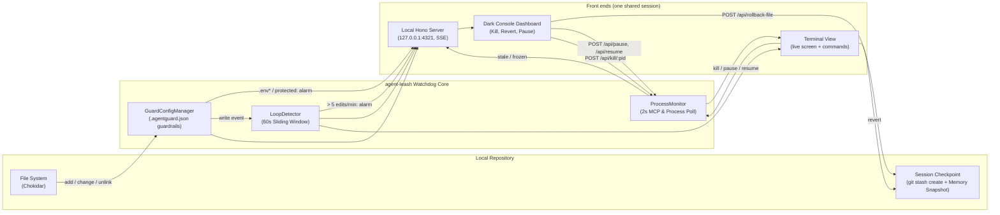

<div align="center">


<br />

**See every AI coding agent and MCP server running on your machine, find the forgotten ones, and end them one session at a time. While agents work, agent-leash raises an alarm when one loops on a file or touches `.env`, and pauses them without losing any work. Local only: no account, no telemetry.**

[](https://www.npmjs.com/package/agent-leash)
[](#)
[](./tsconfig.json)
[](./package.json)
[](#security-model)
[](./LICENSE)

```bash
npx agent-leash
```

</div>

---

## Why `agent-leash`?

Coding agents run for hours, in several repositories at once, and each one starts its own MCP servers. Close the editor window or lose the terminal tab, and those processes often keep running: days later they still hold hundreds of megabytes, and nothing tells you which ones are still in use.

`agent-leash` lists them, says what each one is attached to, and lets you end the one you pick. While it runs in a repository, it also watches the files there:

| What happens | Without `agent-leash` | With `agent-leash` |
| :--- | :--- | :--- |
| **Forgotten sessions** *(agent and MCP processes from repositories you left days ago)* | RAM held by processes nobody uses, and no way to tell which ones are still in use | **One process list for the whole machine**: directory, app, age, RAM and measured activity. Old idle sessions are marked `STALE`, orphans `FROZEN`. You end one session, the agent together with the MCP servers it started, after one confirmation that names each process |
| **Edit loops** *(an agent rewrites the same file six times in 30 s to fix a test)* | Burned tokens and a broken file | **Circuit breaker** raises an alarm on edit 6; `revert` brings back the version before the series |
| **Protected files** *(an agent edits `.env.local` or `docker-compose.yml`)* | Secrets or container configs change silently | **Alarm** at once. `.env*` contents are never read; `revert` restores `docker-compose.yml` |
| **A run going wrong** *(an agent changes 40 files you did not expect)* | Stop it and lose the work, or let it go on | **`pause`** holds the agents of this repository where they are; nothing is lost, `resume` continues them, and you `revert` single files |

agent-leash never ends a process or rewrites a file on its own. Everything that changes something asks first.

---

## Quickstart

No account, no API keys, no config file. In any repository:

```bash
npx agent-leash            # watch this repository: live view in this terminal, dashboard on http://localhost:4321
npx agent-leash status     # or just print the process table once, read-only
npx agent-leash --demo     # or try a simulation first: changes no file and no process
```

Stop it by typing `exit` (or `q`, or Ctrl+C).

Want other limits or more protected files in this repository? See and change the settings from the terminal (details in [Configuration](#configuration)):

```bash
npx agent-leash config                      # every setting, its value and where it comes from
npx agent-leash config set maxFilesWarn 25  # change one value; a running agent-leash applies it at once
```

---

## Finding Forgotten Processes

The process list covers the whole machine, not just the watched repository. Each row shows the process, its working directory, the app or terminal it is attached to (VS Code, Claude Desktop, a terminal …), its age, its RAM, and a status:

| Status | What agent-leash observed |
| :--- | :--- |
| `ACTIVE` | It used CPU time since the last scan |
| `IDLE` | It used none; an agent of the watched repository is only ever `ACTIVE` or `IDLE` |
| `STANDBY` | An MCP server whose parent is alive, waiting for its next tool call. An MCP server of an editor or desktop app that is still running stays `STANDBY`, however long it waits |
| `STALE` | Older than 6 hours, and in ten minutes of watching it started no new process (a working agent runs tools: a shell, `git`, tests) and used less than 8 seconds of CPU time: a session in another repository, or an MCP server that no running app holds |
| `FROZEN` | Its parent is gone (an app that macOS started from the Dock or Finder does not count), it is at least 45 seconds old and used no CPU time since the last scan |

These are observations, not verdicts: nothing is labeled safe to kill, and there is no bulk cleanup. An idle session at an editor window you will come back to tomorrow looks the same as a forgotten one. You end a process with `kill <pid>` in the terminal or from its row in the dashboard, after a confirmation: SIGTERM first, SIGKILL only if it does not exit.

Ending an agent ends its session: the confirmation lists every monitored process the agent started, one line each, and the RAM they hold together, and they end with it. Otherwise they would stay behind as orphans. That includes its MCP servers and an agent it started in the same directory, with that agent's servers; an agent it started anywhere else (another repository, a subdirectory, or when both run in your home directory) is a session of its own and keeps running. Only what the confirmation listed is ended: a server the agent starts while the question is open keeps running, and a PID that meanwhile belongs to another process is not touched; the log says so. If the list does not fit your terminal, the answer is not taken: make the terminal taller and ask again. Other sessions, editors and their MCP servers are never part of it. To end only one MCP server, `kill` its own PID.

### Which processes count as agents

agent-leash keeps no list of AI products, and it does not care which model an agent talks to. A coding agent is recognized in one of three ways:

1. **By the MCP servers it starts.** An agent that uses MCP is the parent of its MCP servers, whatever the agent is called. Editors, desktop apps and terminals that start MCP servers are never taken for agents.
2. **By name**, for the agents that come built in: `claude`, `codex` and `aider`, matched by their exact program name, never as part of another name.
3. **By your list**, for any other agent: `npx agent-leash config set agents vibe,opencode`.

The file guard needs no list at all: it sees every change in the watched repository, whoever makes it.

---

## In the Terminal

Started in a terminal, `agent-leash` shows a full-screen live view of the same state the dashboard shows: modified files, circuit breaker, the activity log and the process table. A command line at the bottom does what the dashboard buttons do:

| Command | What it does |
| :--- | :--- |
| `exit`, `quit`, `q` | Stop the watchdog (Ctrl+C and Ctrl+D work too) |
| `revert <file>` | Roll one file back to the version before its latest series of changes (Tab completes file names) |
| `kill <pid>` | Terminate one process from the list: SIGTERM first, SIGKILL if it does not exit. For an agent, the processes it started end with it ([details](#finding-forgotten-processes)) |
| `pause` | Hold the coding agents of this repository and the processes they started (SIGSTOP); nothing is terminated, no file is touched |
| `resume` | Continue what `pause` held |
| `status` | List all monitored processes |
| `help` | Show the commands |

`revert`, `kill` and `pause` ask `[y/N]` before they act; `pause` names the processes first. `resume` needs no confirmation. Nothing else ever rewrites a file: see [Alarms and Rollback](#alarms-and-rollback).

`pause` holds the agents of the watched repository and the processes they started. Your dev server, your editor and the sessions in other repositories keep running.

Without a terminal (a pipe, a log file, a background job, or `--no-tui`) the same information is printed as one line per event, and the same commands are read from stdin, one per line. The end of the input does not stop the watchdog; `kill -TERM` does.

```bash
npx agent-leash watch ./my-repo --no-dashboard     # terminal only, no web server
npx agent-leash watch ./my-repo --no-tui --quiet   # log lines, alerts only
npx agent-leash status                             # one-time process table
```

---

## How It Works (Architecture)



### Key Engineering Details

1. **Dual-Layer Session Checkpoint (`git stash create` + Memory Snapshot, Zero-Secret-Access for `.env*`)**: On startup, `agent-leash` creates an invisible Git commit object without touching your working tree or stash reflog, paired with an in-memory snapshot for code files. `.env*` files are strictly metadata-monitored (warn-only): their contents are **never** read into memory or overwritten on disk. A fixed list of directories (`node_modules`, `.git`, `dist`, `.next`, `coverage`, `playwright-report`, `test-results`) is always skipped. In a git repository, files git ignores (virtual environments, caches, local databases, logs) are not read into memory, raise no alarm and are never restored, except files that match `protectedFiles`: an ignored directory is still searched for them. Ignore rules are read when the watchdog starts. If they change during the session (a `.gitignore`, `.git/info/exclude`, a git config file), a warning is logged, and files created after that are watched whatever git says.
2. **Rollbacks That Lose Nothing**: agent-leash never rolls a file back on its own. For every changed file it keeps the version from before its latest series of changes, and `revert` restores exactly that one, never anything older. Before a rollback overwrites or removes a file, the version being replaced is copied to a private temp directory (the path is in the log and in the exit summary). A rollback only touches files inside the watched repository, and only deletes a file that did not exist before its latest changes. `agent-leash` recognizes the file system echo of its own rollback by content, so the rollback never triggers a second alert.
3. **Process Lifecycle (`STANDBY` vs. `STALE` vs. `FROZEN`)**: Naive watchdogs flag every `0% CPU` MCP server as frozen, even though stdio MCP servers legitimately sit at `0% CPU` waiting for tool calls. `ProcessMonitor` inspects the process tree (`PPID`), working directory (`lsof -d cwd`), physical RAM (`RSS` in MB), uptime (`etime`) and the CPU time used between scans (`time`, not the `%cpu` average) to tell **standby MCP children** (`STANDBY`) from **old sessions in other repos** (`STALE`) and **orphaned processes whose parent is gone** (`FROZEN`); a process that is merely quiet is not frozen. The tree also tells which agent started which process, so `pause` holds exactly the agents of the watched repository and what they started.

---

## Alarms and Rollback

agent-leash never rewrites a file on its own. A protected file that changes and an agent that rewrites the same file again and again (the circuit breaker) raise an alarm, and the file stays exactly as the agent left it. In a long session an automatic rollback would throw away hours of good work.

You decide, with one command and a confirmation:

- **`revert <file>`** restores the version the file had before its latest series of changes. A series ends when the file stays unchanged for a minute, so the good work before a thrashing loop survives. A second `revert` does not go further back. A file created in the latest series is removed.
- **`pause`** is the emergency brake. It holds the agents of the repository where they are (SIGSTOP): no process is terminated, no file is touched, and `resume` continues them. A long autonomous run is paid work; you look at what happened and decide file by file. There is deliberately no command that rolls back many files at once.

Every version a rollback replaces is kept in a private temp directory, so even a rollback you regret can be undone by hand. Files larger than 5 MB are not kept in memory; for those, `revert` can only go back to the session start (through git) when that is their last stable version, and refuses otherwise.

The circuit breaker raises one alarm per series and re-arms after a quiet minute.

---

## What It Watches For

There are no modes to choose from: agent-leash always watches exactly by your settings, so no switch can quietly turn a protection off.

| Guardrail | Default | What happens |
| :--- | :--- | :--- |
| Protected files | `.env*`, `docker-compose*.yml` | A change raises a critical alarm; `revert` restores the file. `.env*` only warns, because agent-leash never reads its contents and so can never restore it |
| Circuit breaker | more than 5 edits to one file within 60 seconds | One alarm per series of edits; `revert` restores the version before the series |
| Modified files | warning at 15, hard-stop alarm at 40 | An alarm in the terminal view, the log and the dashboard. It does not stop the agent: a hard stop is an alarm, not a brake |

Every value can be changed, see [Configuration](#configuration).

---

## Configuration

agent-leash works without any configuration. To change a value for one repository, put an `.agentguard.json` in its root. Commit it if your team should share the settings, or add it to `.gitignore` if they are yours alone.

```bash
npx agent-leash config                       # every setting: value, where it comes from, what it does
npx agent-leash config set maxFilesWarn 25   # change one value (creates the file if needed)
npx agent-leash config set protectedFiles '.env*, docker-compose*.yml, secrets/**'
npx agent-leash config unset maxFilesWarn    # back to the default
npx agent-leash init                         # or write a file with every default, to edit by hand
```

`config set` and `config unset` change one key and leave the rest of the file as it is; `-C <dir>` points them at another repository. Keys work with or without the `limits.` prefix.

| Setting | Default | What it does |
| :--- | :--- | :--- |
| `limits.maxFilesWarn` | `15` | Files modified in this session before a warning |
| `limits.maxFilesHardStop` | `40` | Files modified in this session before the hard-stop alarm |
| `limits.maxEditsPerFilePerMinute` | `5` | Edits to one file within 60 seconds before the circuit breaker raises an alarm |
| `limits.mcpSilenceTimeoutSec` | `45` | Seconds without CPU activity before an orphaned process (its parent is gone) counts as frozen |
| `limits.staleSessionHours` | `6` | Hours after which an agent session in another repository counts as stale, if in ten minutes of watching it also started no new process and used less than 8 s of CPU time |
| `protectedFiles` | `.env*`, `docker-compose*.yml` | Globs relative to the repository root. Your list replaces the default one, so keep `.env*` in it if you want those warnings |
| `agents` | none | More program names to treat as coding agents, e.g. `vibe`. Not needed for agents that start MCP servers, nor for Claude Code, Codex and Aider ([how agents are recognized](#which-processes-count-as-agents)) |

**Changes apply while agent-leash runs.** A saved change is picked up within about a second, whether it comes from `config set` or from your editor, and the activity log says what changed, for example `.agentguard.json reloaded: limits.maxFilesWarn 15 → 25`. Reloads are logged as warnings, so they also show with `--quiet`: the agent you are watching can write this file as easily as you can. An edit that is not valid (broken JSON, a limit below 1) is not applied at all; the previous settings stay and the log says why. At startup, an invalid value falls back to its default with a warning. Edits to `.agentguard.json` itself are never counted as agent edits and never reverted.

**One repository per instance, every process in view.** File guarding is per repository: each watched repository has its own checkpoint and its own settings. There is no global configuration file. The process monitor is machine-wide: every instance lists the agent and MCP processes of the whole machine, and `limits.staleSessionHours` decides when a session in another repository counts as stale. To guard several repositories, start one agent-leash in each; if the default dashboard port is taken, the next free one is used.

<details>
<summary><strong>Every setting in one file</strong> (the values <code>agent-leash init</code> writes)</summary>

```json
{
  "protectedFiles": [".env*", "docker-compose*.yml"],
  "agents": [],
  "limits": {
    "maxFilesWarn": 15,
    "maxFilesHardStop": 40,
    "maxEditsPerFilePerMinute": 5,
    "mcpSilenceTimeoutSec": 45,
    "staleSessionHours": 6
  }
}
```
</details>

---

## Programmatic TypeScript API

`agent-leash` ships with TypeScript declarations and can be embedded into custom agent runners. Importing it never starts the CLI.

```ts
import {
  GuardConfigManager,
  ProcessMonitor,
  RepoWatcher,
  WatchdogSession,
  listenWatchdogServer,
} from 'agent-leash';

const rootDir = process.cwd();
const configManager = new GuardConfigManager(rootDir);
const watcher = new RepoWatcher({ rootDir, configManager });
const processMonitor = new ProcessMonitor({ rootDir, mcpSilenceTimeoutSec: 45 });

// One session: every front end reads its snapshot and acts through it
const session = new WatchdogSession({ rootDir, configManager, watcher, processMonitor });
session.on('event', (event) => console.log(event.severity, event.message));

await watcher.start();
processMonitor.start();

const dashboard = await listenWatchdogServer({ rootDir, configManager, watcher, processMonitor, session });
console.log(dashboard.url);
```

---

## Security Model

`agent-leash` can terminate processes and rewrite files, so its own surface is kept small:

- The dashboard server binds to `127.0.0.1` and answers only when addressed as this machine.
- Every state-changing request needs a token that is only handed to the dashboard page, and must come from that page's own origin. A web page in another tab cannot trigger anything.
- Only processes from the monitored list can be terminated: one process, or one agent with the processes it started, exactly as the confirmation listed them; `pause` holds only the agents of the watched repository and the processes they started, and agent-leash continues them when it exits: by `exit`, Ctrl+C, SIGTERM, SIGHUP, SIGQUIT, or a crash in its own code. Ended by a signal it does not handle (`kill -9`, or a rarely used one such as SIGUSR2 or SIGALRM), or by a fatal error of Node itself (out of memory), it cannot run anything, and the held processes stay stopped: `kill -CONT <pid>` continues them. Only files inside the watched repository that changed in this session can be rolled back, and never through a symbolic or hard link. `.env*` files (any spelling, including `.envrc`) are never read, written or copied, and `.agentguard.json` is read only when it is a plain file.
- File names and command lines are treated as untrusted text in the dashboard and in the terminal.
- Found a vulnerability? Please report it privately, see [`SECURITY.md`](./SECURITY.md).
- Known limits: another user account on the same machine, or the watched agent itself, can still reach the local dashboard. The watched agent can also edit `.agentguard.json`; a running agent-leash applies the edit and logs it as a warning. The dashboard loads nothing from another host: its styles are generated when the package is built and served by agent-leash itself. It needs a current browser (Chrome 111, Safari 16.4, Firefox 128 or newer).

## Platform Support

Verified on macOS. Linux is implemented but not yet verified, and its process classification is less reliable. Windows is not supported: file watching works, process monitoring does not.

---

## Project Structure

```text
agent-leash/
├── assets/                  # SVG banner
├── scripts/
│   ├── agents/              # Guard hook for coding agents working on this repo
│   └── scenarios/           # Sandbox repo, pseudo-terminal driver, package check
├── src/
│   ├── cli.ts               # Binary entry point
│   ├── index.ts             # Library entry point (importing it starts nothing)
│   ├── program.ts           # Commands, argument validation, wiring, shutdown
│   ├── server.ts            # Hono HTTP server, request guards & SSE stream (/api/events)
│   ├── core/
│   │   ├── session.ts       # One snapshot and one set of actions for every front end
│   │   ├── watcher.ts       # Chokidar file watcher, checkpoint, rollback & kept copies
│   │   ├── loop-detector.ts # 60-second sliding-window thrashing circuit breaker
│   │   ├── process-monitor.ts # Process list, classification & graceful termination
│   │   └── guard-config.ts  # .agentguard.json manager, validation & glob matcher
│   └── ui/
│       ├── terminal.ts      # Full-screen terminal view with command line
│       ├── plain.ts         # Line output for pipes, logs and background jobs
│       ├── commands.ts      # Command language shared by both terminal front ends
│       ├── format.ts        # Sanitizing, truncation, colors, tables
│       ├── styles/
│       │   └── dashboard.css # Tailwind input for npm run build:css
│       └── public/
│           ├── index.html   # The dashboard page (native dialog, no framework)
│           └── dashboard.css # Its styles, generated from the classes in index.html
└── tests/                   # Vitest: unit, API, dashboard script, CLI end-to-end
```

## Contributing & Local Development

```bash
git clone https://github.com/uwejettkant/agent-leash.git
cd agent-leash
npm install

npm run check     # Typecheck, 230 automated tests (Vitest), build — the gate before every commit
npm test          # Tests only
npm run build     # Bundle library, binary and .d.ts types via tsup
npm run demo      # Simulated session, touches nothing
npm run dev       # Watch this repo from the sources
```

Development needs Node 22.12 or newer. Rules for coding agents working on this repository are in [`AGENTS.md`](./AGENTS.md). Bugs and feature requests go into GitHub issues; security problems are reported privately, see [`SECURITY.md`](./SECURITY.md).

## License

Released under the [MIT License](./LICENSE). Copyright © 2026 [Uwe Jettkant](https://uwe-jettkant.de).
