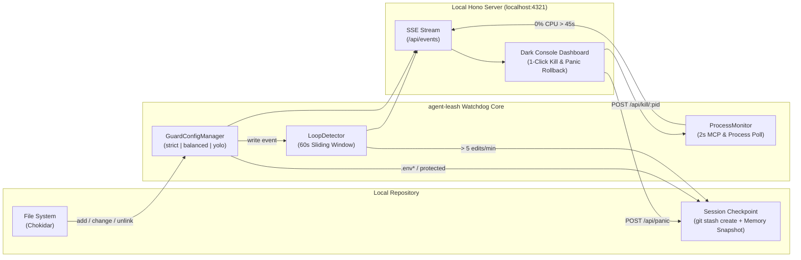

<div align="center">



<br />

**Stop runaway AI coding agents from thrashing your repo, overwriting `.env` files, or hanging in zombie MCP loops — with one command, 100% local, zero cloud.**

[](https://www.npmjs.com/package/agent-leash)
[](#)
[](./tsconfig.json)
[](./package.json)
[](#)
[](./LICENSE)

```bash
npx agent-leash
```


</div>

---

## Why `agent-leash`?

Rules inside `AGENTS.md` or `CLAUDE.md` are polite suggestions. They **cannot** stop an autonomous coding agent once it hallucinates inside a debugging loop or when a local MCP server silently deadlocks in the background.

`agent-leash` is a **41 KB runtime circuit breaker** that sits next to Claude Code, Cursor, Codex, or Antigravity and enforces hard physical boundaries on your file system and OS processes:

| Failure Mode in Autonomous Runs | Without `agent-leash` | With `agent-leash` |
| :--- | :--- | :--- |
| **Edit Thrashing** *(agent rewrites the same file 6× in 30s trying to fix a test)* | Burns tokens and leaves broken code across the working tree | **Circuit Breaker trips** on edit #6 and auto-reverts the file in `<10ms` |
| **Secret / Infra Tampering** *(agent edits `.env.local` or `docker-compose.yml`)* | Secrets or container configs get modified silently | **Instant Alert & Infra Restore** (`.env*` warns immediately without reading/writing secrets; `docker-compose.yml` auto-reverts) |
| **Forgotten Multi-Day Agent & MCP Sessions** *(old sessions from other repos stay alive for days)* | Hundreds of MB of RAM silently locked by stale `claude-code` & MCP trees | **Cross-Repo CWD & Uptime Analysis** flags `STALE` processes (`SAFE TO KILL`) and shows reclaimable RAM in MB |
| **Runaway Multi-File Refactor** *(agent modifies 40+ unintended files)* | Painful manual `git checkout` / untracked file cleanup | **Red Panic Button** restores tracked & untracked files to initial state |

---

## Zero-Friction Quickstart (Time to First Wow: 5 Seconds)

No account, no API keys, no config file required. Run directly in any repository:

```bash
# 1. Protect your current repository & open the live dashboard on http://localhost:4321
npx agent-leash

# 2. Or try the 10-second interactive simulation (simulates a rogue agent + frozen MCP safely in memory)
npx agent-leash --demo
```

Want to customize thresholds per repo? Generate an optional `.agentguard.json`:

```bash
npx agent-leash init
```

---

## How It Works (Architecture)



### Key Engineering Details

1. **Dual-Layer Session Checkpoint (`git stash create` + Memory Snapshot, Zero-Secret-Access for `.env*`)**: On startup, `agent-leash` creates an invisible Git commit object without touching your working tree or stash reflog, paired with an in-memory snapshot for code files. `.env*` files are strictly metadata-monitored (warn-only): their contents are **never** read into memory or overwritten on disk.
2. **Self-Write Suppression**: When `agent-leash` automatically rolls back a file, it suppresses Chokidar events for that path for `400ms` so the rollback itself never triggers a secondary loop alert.
3. **Smart Process Lifecycle (`STANDBY` vs. `STALE` vs. `FROZEN`)**: Naive watchdogs flag every `0% CPU` MCP server as frozen—even though stdio MCP servers legitimately sit at `0% CPU` waiting for tool calls. `ProcessMonitor` inspects the process tree (`PPID`), working directory (`lsof -d cwd`), physical RAM (`RSS` in MB), and uptime (`etime`) to distinguish **healthy standby MCP children** (`STANDBY`) from **forgotten multi-day sessions in other repos** (`STALE · SAFE TO KILL`) and **hung/orphaned processes** (`FROZEN`).

---

## Protection Modes & `.agentguard.json`

Switch modes live in the Web Dashboard (`http://localhost:4321`) or via CLI (`npx agent-leash watch --mode yolo`):

| Mode | File Volume Limits | Protected Globs (`.env*`, `docker-compose*.yml`) | 60s Loop Circuit Breaker | Best For |
| :--- | :--- | :--- | :--- | :--- |
| **`strict`** | Hard stop at **15 files** | `.env*` warn-only; infra configs auto-reverted | **Active** | Surgical bugfixes & hotfixes |
| **`balanced`** *(default)* | Warns at **15**, hard stop at **40** | `.env*` warn-only; infra configs auto-reverted | **Active** | Daily feature work |
| **`yolo`** *(refactoring)* | **Unlimited** | `.env*` warn-only; `.git/**` stays protected | **Active** | Large-scale renames & migrations |

<details>
<summary><strong>Default <code>.agentguard.json</code> schema</strong> (click to expand)</summary>

```json
{
  "mode": "balanced",
  "protectedFiles": [".env*", "docker-compose*.yml", ".git/**"],
  "limits": {
    "maxFilesWarn": 15,
    "maxFilesHardStop": 40,
    "maxEditsPerFilePerMinute": 5,
    "mcpSilenceTimeoutSec": 45
  }
}
```
</details>

---

## Programmatic TypeScript API

`agent-leash` ships with full TypeScript declarations (`dist/cli.d.ts`) and can be embedded into custom agent runners:

```ts
import { GuardConfigManager, RepoWatcher, ProcessMonitor, startWatchdogServer } from 'agent-leash';

const rootDir = process.cwd();
const configManager = new GuardConfigManager(rootDir, { mode: 'balanced' });
const watcher = new RepoWatcher({ rootDir, configManager });
const processMonitor = new ProcessMonitor({ rootDir, mcpSilenceTimeoutSec: 45 });

await watcher.start();
processMonitor.start();

startWatchdogServer({ rootDir, configManager, watcher, processMonitor, port: 4321 });
```

---

## Project Structure

```text
agent-leash/
├── assets/                  # SVG banner, animated demo & Charmbracelet VHS tape
├── src/
│   ├── cli.ts               # CLI entry point (Commander.js + --demo simulator)
│   ├── server.ts            # Hono HTTP server & real-time SSE stream (/api/events)
│   ├── core/
│   │   ├── watcher.ts       # Chokidar file watcher, Git checkpoint & auto-rollback
│   │   ├── loop-detector.ts # 60-second sliding-window thrashing circuit breaker
│   │   ├── process-monitor.ts # 2s OS process heartbeat for MCP & agent child processes
│   │   └── guard-config.ts  # .agentguard.json manager & glob matcher
│   └── ui/
│       └── public/
│           └── index.html   # Zero-build Dark Console SPA (Tailwind + Native Dialog)
└── tests/                   # Automated Vitest unit & integration test suites
```

## Contributing & Local Development

```bash
git clone https://github.com/uwejettkant/agent-leash.git
cd agent-leash
npm install

npm test          # Run 14 automated unit & integration tests (Vitest)
npm run build     # Bundle CJS CLI + .d.ts types via tsup (41 KB)
npm run dev       # Start watchdog in development mode
```

## License

Released under the [MIT License](./LICENSE). Copyright © 2026 [Uwe Jettkant](https://uwe-jettkant.de).
