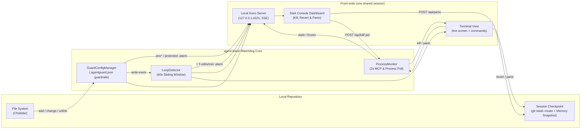

<div align="center">


<br />

**Stop runaway AI coding agents from thrashing your repo, overwriting `.env` files, or leaving forgotten MCP processes behind — with one command, on your machine, no account, no telemetry.**

[](https://www.npmjs.com/package/agent-leash)
[](#)
[](./tsconfig.json)
[](./package.json)
[](#security-model)
[](./LICENSE)

```bash
npx agent-leash
```


<sub>The animation predates the full-screen terminal view; run <code>npx agent-leash --demo</code> to see the current one.</sub>

</div>

---

## Why `agent-leash`?

Rules inside `AGENTS.md` or `CLAUDE.md` are polite suggestions. They **cannot** stop an autonomous coding agent once it hallucinates inside a debugging loop or when a local MCP server silently deadlocks in the background.

`agent-leash` is a small runtime circuit breaker that sits next to any coding agent (Claude Code, Codex, Cursor, Antigravity, …) and watches your file system and OS processes:

| Failure Mode in Autonomous Runs | Without `agent-leash` | With `agent-leash` |
| :--- | :--- | :--- |
| **Edit Thrashing** *(agent rewrites the same file 6× in 30s trying to fix a test)* | Burns tokens and leaves broken code across the working tree | **Circuit Breaker** raises an alarm on edit #6; `revert` brings back the version before the series |
| **Secret / Infra Tampering** *(agent edits `.env.local` or `docker-compose.yml`)* | Secrets or container configs get modified silently | **Instant Alert** (`.env*` warns without its contents ever being read; `revert` restores `docker-compose.yml`) |
| **Forgotten Multi-Day Agent & MCP Sessions** *(old sessions from other repos stay alive for days)* | Hundreds of MB of RAM silently locked by stale agent & MCP trees | **Cross-Repo Process List** shows every agent and MCP process with directory, uptime and RAM, marks old ones `STALE`; you end them one PID at a time |
| **Runaway Multi-File Refactor** *(agent modifies 40+ unintended files)* | Painful manual `git checkout` / untracked file cleanup | **Panic** stops the agents of the repo and rolls back what changed in the last 10 minutes, after one confirmation |

---

## Zero-Friction Quickstart (Time to First Wow: 5 Seconds)

No account, no API keys, no config file required. Run directly in any repository:

```bash
# 1. Protect your current repository: live view in this terminal, dashboard on http://localhost:4321
npx agent-leash

# 2. Or try the simulation first (a rogue agent and stale processes; changes no file and no process)
npx agent-leash --demo
```

Stop it by typing `exit` (or `q`, or Ctrl+C).

Want other limits or more protected files in this repository? See and change the settings from the terminal (details in [Configuration](#configuration)):

```bash
npx agent-leash config                      # every setting, its value and where it comes from
npx agent-leash config set maxFilesWarn 25  # change one value; a running agent-leash applies it at once
```

---

## In the Terminal

Started in a terminal, `agent-leash` shows a full-screen live view of the same state the dashboard shows: modified files, circuit breaker, the activity log and the process table. A command line at the bottom does what the dashboard buttons do:

| Command | What it does |
| :--- | :--- |
| `exit`, `quit`, `q` | Stop the watchdog (Ctrl+C and Ctrl+D work too) |
| `revert <file>` | Roll one file back to the version before its latest series of changes (Tab completes file names) |
| `kill <pid>` | Terminate one process from the list: SIGTERM first, SIGKILL if it does not exit |
| `panic` | Stop the coding agents of this repository and the processes they started, and roll back the files changed in the last 10 minutes |
| `status` | List all monitored processes |
| `help` | Show the commands |

`revert`, `kill` and `panic` ask `[y/N]` before they act; `panic` names the processes and the number of files first. Nothing else ever rewrites a file: see [Alarms and Rollback](#alarms-and-rollback).

Without a terminal (a pipe, a log file, a background job, or `--no-tui`) the same information is printed as one line per event, and the same commands are read from stdin, one per line. The end of the input does not stop the watchdog; `kill -TERM` does.

```bash
npx agent-leash watch ./my-repo --no-dashboard     # terminal only, no web server
npx agent-leash watch ./my-repo --no-tui --quiet   # log lines, alerts only
npx agent-leash status                             # one-time process table
```

---

## Which Agents It Recognizes

agent-leash keeps no list of AI products, and it does not care which model an agent talks to. The file guard needs no list at all: it sees every change, whoever makes it. For the process list, a coding agent is recognized in one of three ways:

1. **By the MCP servers it starts.** An agent that uses MCP is the parent of its MCP servers, whatever the agent is called. Editors, desktop apps and terminals that start MCP servers are never taken for agents.
2. **By name**, for the agents that come built in: `claude`, `codex` and `aider`, matched by their exact program name, never as part of another name.
3. **By your list**, for any other agent: `npx agent-leash config set agents vibe,opencode`.

`panic` stops the agents of the watched repository and the processes they started. Your dev server, your editor and the sessions in other repositories keep running.

The process list marks old sessions in other repositories as `STALE` and processes whose parent is gone as `FROZEN`. Those are observations, not verdicts: nothing is labeled safe to kill, and there is no bulk cleanup. You end a process with `kill <pid>` after a confirmation, or from its row in the dashboard.

---

## How It Works (Architecture)



### Key Engineering Details

1. **Dual-Layer Session Checkpoint (`git stash create` + Memory Snapshot, Zero-Secret-Access for `.env*`)**: On startup, `agent-leash` creates an invisible Git commit object without touching your working tree or stash reflog, paired with an in-memory snapshot for code files. `.env*` files are strictly metadata-monitored (warn-only): their contents are **never** read into memory or overwritten on disk.
2. **Rollbacks That Lose Nothing**: agent-leash never rolls a file back on its own. For every changed file it keeps the version from before its latest series of changes, and `revert` or `panic` restore exactly that one, never anything older. Before a rollback overwrites or removes a file, the version being replaced is copied to a private temp directory (the path is in the log and in the exit summary). A rollback only touches files inside the watched repository, and only deletes a file that did not exist before its latest changes. `agent-leash` recognizes the file system echo of its own rollback by content, so the rollback never triggers a second alert.
3. **Process Lifecycle (`STANDBY` vs. `STALE` vs. `FROZEN`)**: Naive watchdogs flag every `0% CPU` MCP server as frozen, even though stdio MCP servers legitimately sit at `0% CPU` waiting for tool calls. `ProcessMonitor` inspects the process tree (`PPID`), working directory (`lsof -d cwd`), physical RAM (`RSS` in MB) and uptime (`etime`) to tell **standby MCP children** (`STANDBY`) from **old sessions in other repos** (`STALE`) and **orphaned or silent processes** (`FROZEN`). The tree also tells which agent started which process, so `panic` reaches exactly the agents of the watched repository and what they started.

---

## Alarms and Rollback

agent-leash never rewrites a file on its own. A protected file that changes and an agent that rewrites the same file again and again (the circuit breaker) raise an alarm, and the file stays exactly as the agent left it. In a long session an automatic rollback would throw away hours of good work.

You decide, with one command and a confirmation:

- **`revert <file>`** restores the version the file had before its latest series of changes. A series ends when the file stays unchanged for a minute, so the good work before a thrashing loop survives. A second `revert` does not go further back. A file created in the latest series is removed.
- **`panic`** stops the agents of the repository and rolls back every file changed in the last 10 minutes, each to its version before its latest changes. Older changes stay as they are; the confirmation says how many.

Every version a rollback replaces is kept in a private temp directory, so even a rollback you regret can be undone by hand. Files larger than 5 MB are not kept in memory; for those, `revert` can only go back to the session start (through git) when that is their last stable version, and refuses otherwise.

The circuit breaker raises one alarm per series and re-arms after a quiet minute.

---

## What It Watches For

There are no modes to choose from: agent-leash always watches exactly by your settings, so no switch can quietly turn a protection off.

| Guardrail | Default | What happens |
| :--- | :--- | :--- |
| Protected files | `.env*`, `docker-compose*.yml`, `.git/**` | A change raises a critical alarm; `revert` restores the file. `.env*` only warns, because agent-leash never reads its contents and so can never restore it |
| Circuit breaker | more than 5 edits to one file within 60 seconds | One alarm per series of edits; `revert` restores the version before the series |
| Modified files | warning at 15, hard-stop alarm at 40 | An alarm in the terminal view, the log and the dashboard. It does not stop the agent: a hard stop is an alarm, not a brake |

Every value can be changed, see [Configuration](#configuration).

---

## Configuration

agent-leash works without any configuration. To change a value for one repository, put an `.agentguard.json` in its root. Commit it if your team should share the settings, or add it to `.gitignore` if they are yours alone.

```bash
npx agent-leash config                       # every setting: value, where it comes from, what it does
npx agent-leash config set maxFilesWarn 25   # change one value (creates the file if needed)
npx agent-leash config set protectedFiles '.env*, docker-compose*.yml, secrets/**'
npx agent-leash config unset maxFilesWarn    # back to the default
npx agent-leash init                         # or write a file with every default, to edit by hand
```

`config set` and `config unset` change one key and leave the rest of the file as it is; `-C <dir>` points them at another repository. Keys work with or without the `limits.` prefix.

| Setting | Default | What it does |
| :--- | :--- | :--- |
| `limits.maxFilesWarn` | `15` | Files modified in this session before a warning |
| `limits.maxFilesHardStop` | `40` | Files modified in this session before the hard-stop alarm |
| `limits.maxEditsPerFilePerMinute` | `5` | Edits to one file within 60 seconds before the circuit breaker raises an alarm |
| `limits.mcpSilenceTimeoutSec` | `45` | Seconds without CPU or file activity before a process counts as frozen |
| `limits.staleSessionHours` | `6` | Hours after which an agent session in another repository counts as stale |
| `protectedFiles` | `.env*`, `docker-compose*.yml`, `.git/**` | Globs relative to the repository root. Your list replaces the default one, so keep `.env*` in it if you want those warnings |
| `agents` | none | More program names to treat as coding agents, e.g. `vibe`. Not needed for agents that start MCP servers, nor for Claude Code, Codex and Aider ([how agents are recognized](#which-agents-it-recognizes)) |

**Changes apply while agent-leash runs.** A saved change is picked up within about a second, whether it comes from `config set` or from your editor, and the activity log says what changed, for example `.agentguard.json reloaded: limits.maxFilesWarn 15 → 25`. Reloads are logged as warnings, so they also show with `--quiet`: the agent you are watching can write this file as easily as you can. An edit that is not valid (broken JSON, a limit below 1) is not applied at all; the previous settings stay and the log says why. At startup, an invalid value falls back to its default with a warning. Edits to `.agentguard.json` itself are never counted as agent edits and never reverted.

**One repository per instance, every process in view.** File guarding is per repository: each watched repository has its own checkpoint and its own settings. There is no global configuration file. The process monitor is machine-wide: every instance lists the agent and MCP processes of the whole machine, and `limits.staleSessionHours` decides when a session in another repository counts as stale. To guard several repositories, start one agent-leash in each; if the default dashboard port is taken, the next free one is used.

<details>
<summary><strong>Every setting in one file</strong> (the values <code>agent-leash init</code> writes)</summary>

```json
{
  "protectedFiles": [".env*", "docker-compose*.yml", ".git/**"],
  "agents": [],
  "limits": {
    "maxFilesWarn": 15,
    "maxFilesHardStop": 40,
    "maxEditsPerFilePerMinute": 5,
    "mcpSilenceTimeoutSec": 45,
    "staleSessionHours": 6
  }
}
```
</details>

---

## Programmatic TypeScript API

`agent-leash` ships with TypeScript declarations and can be embedded into custom agent runners. Importing it never starts the CLI.

```ts
import {
  GuardConfigManager,
  ProcessMonitor,
  RepoWatcher,
  WatchdogSession,
  listenWatchdogServer,
} from 'agent-leash';

const rootDir = process.cwd();
const configManager = new GuardConfigManager(rootDir);
const watcher = new RepoWatcher({ rootDir, configManager });
const processMonitor = new ProcessMonitor({ rootDir, mcpSilenceTimeoutSec: 45 });

// One session: every front end reads its snapshot and acts through it
const session = new WatchdogSession({ rootDir, configManager, watcher, processMonitor });
session.on('event', (event) => console.log(event.severity, event.message));

await watcher.start();
processMonitor.start();

const dashboard = await listenWatchdogServer({ rootDir, configManager, watcher, processMonitor, session });
console.log(dashboard.url);
```

---

## Security Model

`agent-leash` can terminate processes and rewrite files, so its own surface is kept small:

- The dashboard server binds to `127.0.0.1` and answers only when addressed as this machine.
- Every state-changing request needs a token that is only handed to the dashboard page, and must come from that page's own origin. A web page in another tab cannot trigger anything.
- Only processes from the monitored list can be terminated, one PID at a time; `panic` reaches only the agents of the watched repository and the processes they started. Only paths inside the watched repository can be rolled back. `.env*` files are never read, written or copied.
- File names and command lines are treated as untrusted text in the dashboard and in the terminal.
- Found a vulnerability? Please report it privately, see [`SECURITY.md`](./SECURITY.md).
- Known limits: another user account on the same machine, or the watched agent itself, can still reach the local dashboard. The watched agent can also edit `.agentguard.json`; a running agent-leash applies the edit and logs it as a warning. The dashboard page loads Tailwind from its CDN; with `--no-dashboard` no network request is made at all.

## Platform Support

Verified on macOS. Linux is implemented but not yet verified, and its process classification is less reliable. Windows is not supported: file watching works, process monitoring does not.

---

## Project Structure

```text
agent-leash/
├── assets/                  # SVG banner, demo animation & Charmbracelet VHS tape
├── scripts/
│   ├── agents/              # Guard hook for coding agents working on this repo
│   └── scenarios/           # Sandbox repo, pseudo-terminal driver, package check
├── src/
│   ├── cli.ts               # Binary entry point
│   ├── index.ts             # Library entry point (importing it starts nothing)
│   ├── program.ts           # Commands, argument validation, wiring, shutdown
│   ├── server.ts            # Hono HTTP server, request guards & SSE stream (/api/events)
│   ├── core/
│   │   ├── session.ts       # One snapshot and one set of actions for every front end
│   │   ├── watcher.ts       # Chokidar file watcher, checkpoint, rollback & kept copies
│   │   ├── loop-detector.ts # 60-second sliding-window thrashing circuit breaker
│   │   ├── process-monitor.ts # Process list, classification & graceful termination
│   │   └── guard-config.ts  # .agentguard.json manager, validation & glob matcher
│   └── ui/
│       ├── terminal.ts      # Full-screen terminal view with command line
│       ├── plain.ts         # Line output for pipes, logs and background jobs
│       ├── commands.ts      # Command language shared by both terminal front ends
│       ├── format.ts        # Sanitizing, truncation, colors, tables
│       └── public/
│           └── index.html   # Zero-build Dark Console SPA (Tailwind + Native Dialog)
└── tests/                   # Vitest: unit, API, dashboard script, CLI end-to-end
```

## Contributing & Local Development

```bash
git clone https://github.com/uwejettkant/agent-leash.git
cd agent-leash
npm install

npm run check     # Typecheck, 177 automated tests (Vitest), build — the gate before every commit
npm test          # Tests only
npm run build     # Bundle library, binary and .d.ts types via tsup
npm run demo      # Simulated session, touches nothing
npm run dev       # Watch this repo from the sources
```

Development needs Node 22.12 or newer. Rules for coding agents working on this repository are in [`AGENTS.md`](./AGENTS.md). Bugs and feature requests go into GitHub issues; security problems are reported privately, see [`SECURITY.md`](./SECURITY.md).

## License

Released under the [MIT License](./LICENSE). Copyright © 2026 [Uwe Jettkant](https://uwe-jettkant.de).
